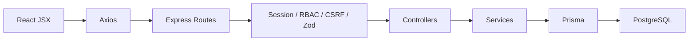

# Kiến trúc

npm workspaces frontend/backend, ESM. Backend controller xử lý HTTP, service giữ nghiệp vụ. Một Prisma client và pg adapter dùng chung. Error middleware chuẩn hóa lỗi và loại dữ liệu nhạy cảm. Frontend dùng contexts cho phiên và giỏ hàng, hooks cho API/bộ lọc, services cho HTTP.

## Quyết định nền tảng

Generator prisma-client được khuyến nghị sinh mã vào backend/generated. Ứng dụng import từ JS, Node 24.12+ thực thi mã tự sinh bằng native type stripping, không thêm TypeScript compiler. Mã generated không được commit. M0 kiểm chứng native và Docker trước khi xây nghiệp vụ.

Phát triển chạy Vite và Express riêng, Vite proxy /api. Bản Docker Express phục vụ frontend/dist cùng origin. PostgreSQL volume giữ dữ liệu. Seed là lệnh riêng, secret local trong .env.

## Backend

Modules auth, employees, categories, products, inventory, customers, promotions, sales, invoices và reports. Mỗi module có routes, validators, controllers, services. Config env/Prisma tập trung, middlewares dùng chung cho auth/CSRF/RBAC/Zod/error. Routes dùng schema Zod làm contract input. OpenAPI lấy input schema từ cùng validators.

AuthSession lưu user/expiry/revocation/CSRF. JWT chứa sub và session ID, kiểm tra HS256/issuer/audience. Middleware đọc user hiện tại từ DB, giúp khóa tài khoản có hiệu lực ngay. Login rate-limit theo IP cho lần thất bại, checkout theo user. Error response có request ID, log loại credential/token.

Service quote đọc sản phẩm/danh mục/khách/khuyến mại và tính Decimal. Checkout so quoteHash rồi gọi recordSale trong Serializable transaction. recordSale ghi invoice/items, giảm tồn có điều kiện, ledger và cuối cùng payment. Seed lịch sử dùng cùng writer và bộ tính tiền. Xung đột được retry tối đa ba lần. Unique người lập/key cùng request hash xử lý replay, kể cả yêu cầu đồng thời.

GET invoice ID áp dụng creator scope cho STAFF. Lookup idempotency key luôn dùng người đang đăng nhập, bao gồm MANAGER. Payment/subtotal/discount/line price giữ snapshot. Ngừng hoạt động dùng isActive, FK restrict bảo vệ lịch sử.

Reports aggregate PostgreSQL với tham số, điều kiện PAID + payment. date_trunc dùng Asia/Ho_Chi_Minh, range kết thúc trước đầu ngày kế tiếp. Revenue thiếu kỳ được bổ sung zero. Product monetary subtotal là trước giảm toàn hóa đơn.

## Frontend

Auth context quản lý phiên. Cart context lưu giỏ và request đang chờ trong sessionStorage theo user. Request key/payload được lưu trước khi POST. Khi chưa rõ kết quả, cart khóa chỉnh sửa và recovery tra own-key rồi gửi lại cùng nội dung khi cần.

useResource xử lý cancel/loading/error/retry, hỗ trợ tải đủ các trang danh mục cho dropdown. useListQuery giữ filter/sort/page trong URL. Components common cung cấp bảng, form modal, field errors, confirmation và state panels. Charts lazy-loaded theo route. Giá trị số dùng Number để vẽ, còn totals/tooltip/table giữ chuỗi chính xác và định dạng BigInt.

## Vận hành

Native dev Vite 5173/API 3000, native build Express 3000, Docker app 8080/db nội bộ 5432. DB host port 15432. Integration dùng sales_test, E2E dùng sales_e2e_test và cổng 3001/5174. Fixture xác minh current_database trước cleanup. Docker image dùng Node 24.22.3, user node, prune devDependencies, migration trước readiness và named volume bền vững.
