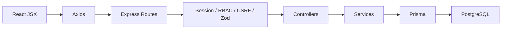

# Kiến trúc

npm workspaces frontend/backend, ESM. Backend controller xử lý HTTP, service giữ nghiệp vụ. Một Prisma client và pg adapter dùng chung. Error middleware chuẩn hóa lỗi và loại dữ liệu nhạy cảm. Frontend dùng contexts cho phiên và giỏ hàng, hooks cho API/bộ lọc, services cho HTTP.

## Quyết định nền tảng

Generator prisma-client được khuyến nghị sinh mã vào backend/generated. Ứng dụng import từ JS, Node 24.12+ thực thi mã tự sinh bằng native type stripping, không thêm TypeScript compiler. Mã generated không được commit. M0 kiểm chứng native và Docker trước khi xây nghiệp vụ.

Phát triển chạy Vite và Express riêng, Vite proxy /api. Bản Docker Express phục vụ frontend/dist cùng origin. PostgreSQL volume giữ dữ liệu. Seed là lệnh riêng, secret local trong .env.
