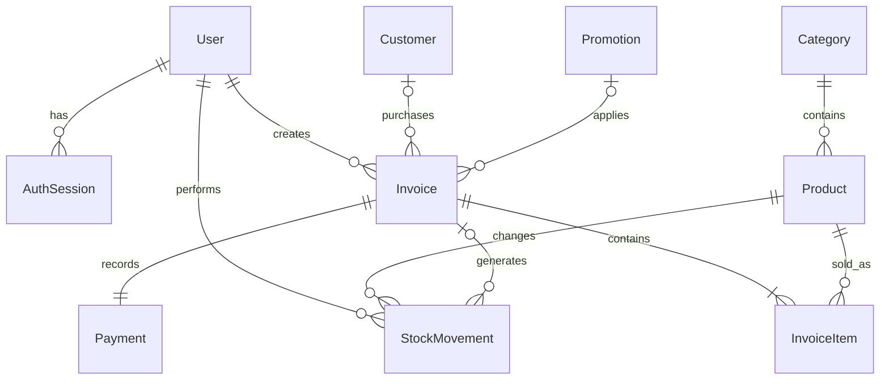

# ERD

Schema và SQL constraints được tạo trong migration init tại M1.

Money Decimal(18,0), percent Decimal, timestamps timestamptz. Snapshot invoice và item giữ lịch sử. Unique email/SKU/promotion code/phone có giá trị, unique người lập + idempotency key. FKs restrict delete. Index theo thời gian hóa đơn, người lập, khách hàng và stock movement sản phẩm.

SQL CHECK kiểm tra product price/stock/threshold không âm, promotion >0 và khoảng thời gian hợp lệ, percent <=100, fixed discount nguyên. Invoice total=subtotal-discount, discount không vượt subtotal. InvoiceItem quantity dương và subtotal=unitPrice*quantity. Payment kiểm tra tiền nhận/thừa theo phương thức. Movement kiểm tra dấu delta theo loại và quantityAfter không âm. Số invoice có sequence duy nhất. FK giữ lịch sử.
