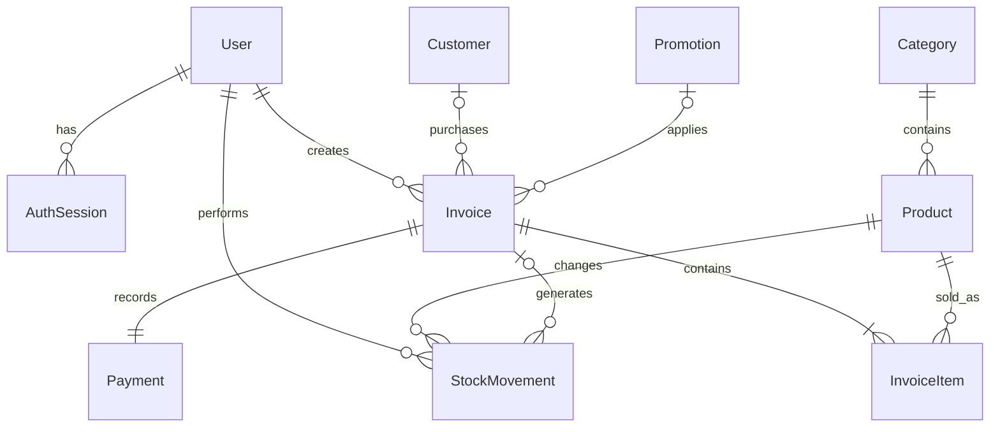

# ERD

Thiết kế quan hệ được phê duyệt dưới đây. Schema và SQL constraints được hoàn thiện tại M1.

Money Decimal(18,0), percent Decimal, timestamps timestamptz. Snapshot invoice và item giữ lịch sử. Unique email/SKU/promotion code/phone có giá trị, unique người lập + idempotency key. FKs restrict delete. Index theo thời gian hóa đơn, người lập, khách hàng và stock movement sản phẩm.
