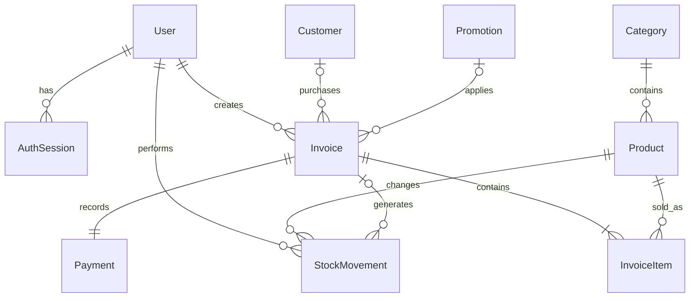

# ERD

Schema và SQL constraints được tạo trong migration init tại M1.

Money Decimal(18,0), percent Decimal, timestamps timestamptz. Snapshot invoice và item giữ lịch sử. Unique email/SKU/promotion code/phone có giá trị, unique người lập + idempotency key. FKs restrict delete. Index theo thời gian hóa đơn, người lập, khách hàng và stock movement sản phẩm.

SQL CHECK kiểm tra product price/stock/threshold không âm, promotion >0 và khoảng thời gian hợp lệ, percent <=100, fixed discount nguyên. Invoice total=subtotal-discount, discount không vượt subtotal. InvoiceItem quantity dương và subtotal=unitPrice*quantity. Payment kiểm tra tiền nhận/thừa theo phương thức. Movement kiểm tra dấu delta theo loại và quantityAfter không âm. Số invoice có sequence duy nhất. FK giữ lịch sử.

| Entity        | Trường nghiệp vụ                                                                                                                                      |
| ------------- | ----------------------------------------------------------------------------------------------------------------------------------------------------- |
| User          | id, email unique, name, passwordHash, role MANAGER/STAFF, isActive, timestamps                                                                        |
| AuthSession   | id, userId FK, csrfToken, expiresAt, revokedAt, createdAt                                                                                             |
| Category      | id, name unique, description, isActive, timestamps                                                                                                    |
| Product       | id, sku unique, name, description, unit, categoryId FK, price, stock, lowStockThreshold, isActive, timestamps                                         |
| Customer      | id, name, phone nullable unique, email/address, isActive, timestamps                                                                                  |
| Promotion     | id, code unique, name, discountType/value, minSubtotal/maxDiscount, startsAt/endsAt, isActive                                                         |
| Invoice       | id, number sequence unique, createdById/customerId/promotionId FKs, snapshots JSON, subtotal/discount/total, PAID, idempotencyKey/requestHash, paidAt |
| InvoiceItem   | id, invoiceId/productId FKs, sku/name/unit snapshots, unitPrice, quantity, subtotal; unique invoice+product                                           |
| Payment       | id, invoiceId unique FK, method, amount, cashReceived/change, transferReference, createdAt                                                            |
| StockMovement | id, productId/actorId/invoiceId FKs, kind/delta/quantityAfter/reason, operationKey/requestHash, createdAt                                             |

Invoice unique [createdById,idempotencyKey]. Movement unique [actorId,operationKey] và [invoiceId,productId], nullable keys cho phép nhiều adjustment/opening. Các index trong schema phục vụ paidAt, creator/customer+paidAt, category+active, product+movement time và active promotion range. Payment là quan hệ tối đa một dòng ở DB; checkout đảm bảo đúng một payment khi commit và reports chỉ cộng invoice có payment.
