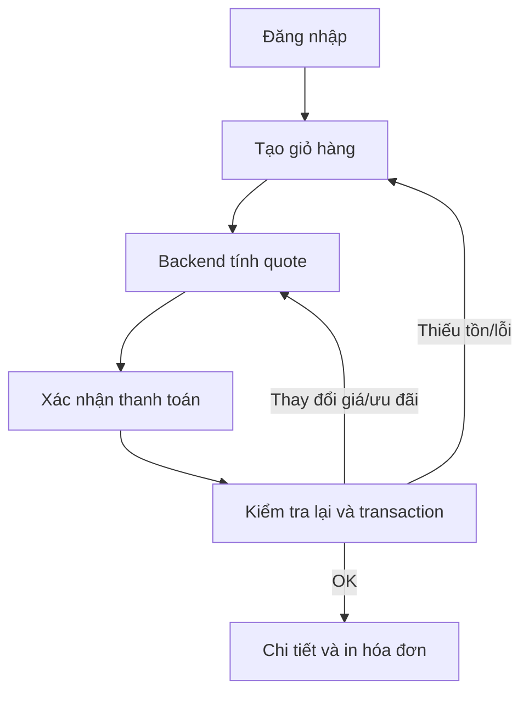

# Use cases

| Actor | Hành động | Kết quả |
| --- | --- | --- |
| Nhân viên | Login, hồ sơ, đổi mật khẩu, logout | Phiên hợp lệ, cookie HttpOnly, phiên thu hồi đúng |
| Nhân viên | Tìm sản phẩm, chọn số lượng, chọn khách/khách lẻ | Giỏ hàng và quote backend |
| Nhân viên | Chọn ưu đãi, xác nhận thanh toán | Một invoice/payment, tồn và ledger khớp |
| Nhân viên | Tra ID/key/hóa đơn của mình, in | Đúng ownership, snapshot và bản in |
| Quản lý | Quản lý sản phẩm/danh mục/giá/nhân viên/khách/ưu đãi | Validation, quyền và trạng thái hoạt động |
| Quản lý | Điều chỉnh tồn với lý do | Tồn không âm, idempotent và có ledger |
| Quản lý | Xem toàn bộ hóa đơn, khách hàng, dashboard/report | Tổng tiền sau giảm, ngày Việt Nam, dữ liệu DB |

Request mất phản hồi giữ key và payload để tra cứu/gửi lại. Cùng key khác payload bị từ chối. Nhân viên khác tra ID/key không đọc được hóa đơn ngoài quyền. Backend kiểm tra dữ liệu tại thời điểm commit.
